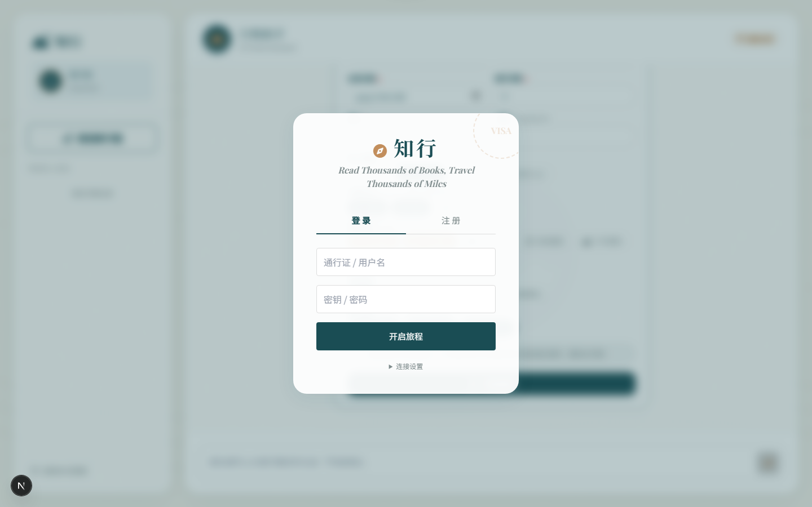
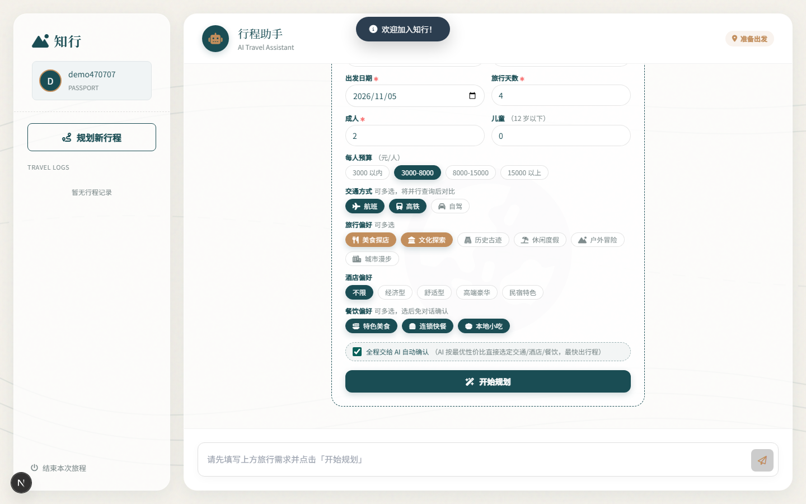
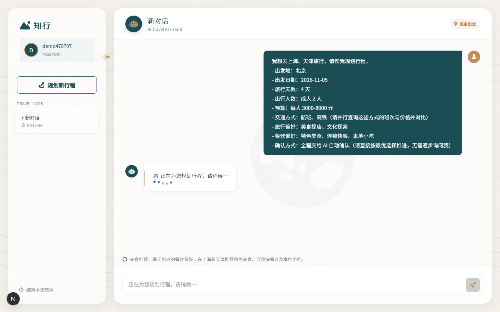
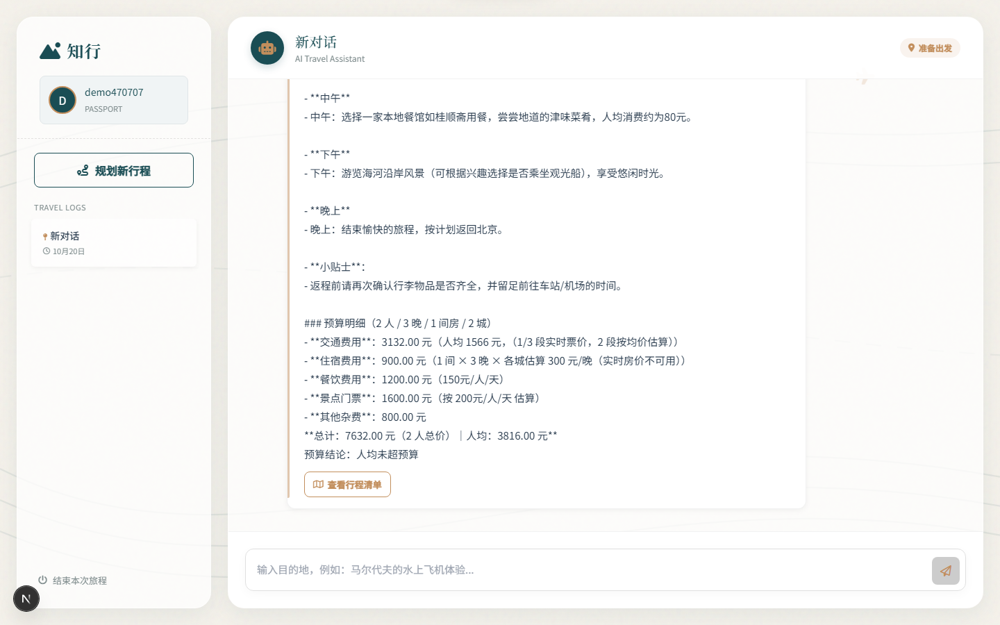
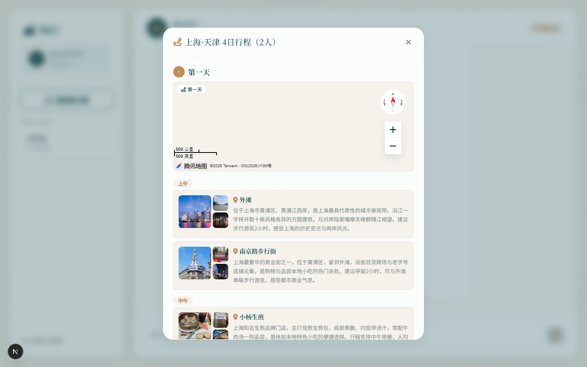
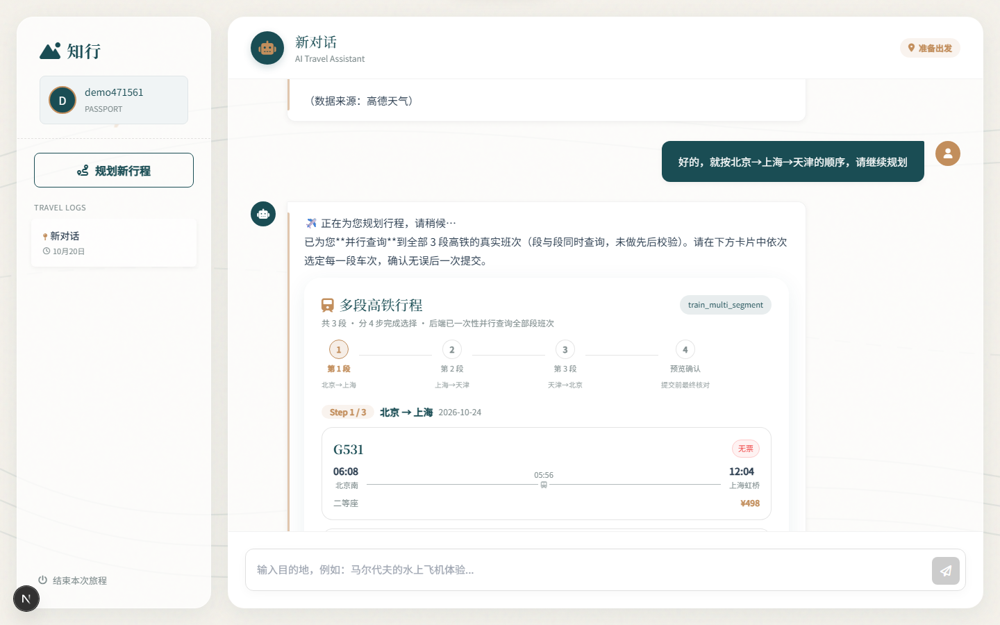

# 知行 ZhiXing —— 多智能体 AI 旅行规划系统

> **Read Thousands of Books, Travel Thousands of Miles · 读万卷书，行万里路**

基于 **LangGraph 多智能体** + **MCP（Model Context Protocol）工具生态** 的智能旅行规划平台。用户只需填写一份旅行需求表单，系统便调度多个专业 Agent 协同完成目的地推荐、交通比价、酒店筛选、餐饮推荐与行程编排，最终产出一份**带地图路线的结构化行程清单**。

支持两种交互模式：**AI 全自动规划**（交通/酒店/餐饮由 AI 按最优性价比直接选定）与 **人工手动确认**（AI 下发高铁/航班/酒店选择卡片，用户逐段手动挑选）。

---

## ✨ 功能演示

### 一、AI 全自动模式
勾选表单中的「全程交给 AI 自动确认」，AI 直接选定交通/酒店/餐饮，最快生成完整行程。

| 登录页 | 旅行需求表单 | 勾选 AI 全自动 |
| --- | --- | --- |
|  |  |  |

| AI 规划中（流式） | 最终行程清单 |
| --- | --- |
|  |  |

| 行程清单弹窗（按天 + 地图路线） |
| --- |
|  |

### 二、人工手动模式
不勾选自动确认，AI 并行查询高铁/航班后，下发**多段选择卡片**供用户手动挑选具体车次。

| 多段高铁手动选择卡片 |
| --- |
|  |

---

## 🚀 核心功能

- **多智能体协同规划**：基于 LangGraph 状态机编排多个专业 Agent（意图路由、目的地推荐、交通、酒店、餐饮、行程编排），各司其职、流水线推进。
- **两种交互模式**：
  - 🤖 **AI 全自动**：一键出全程行程；
  - 🖐️ **人工手动**：高铁/航班/酒店以交互卡片呈现，用户逐段确认。
- **多段交通智能对比**：高铁（12306）、航班（飞常准 Variflight）、自驾（高德路线）并行查询，按时间/价格/性价比对比。
- **结构化行程清单**：按天 × 时段 × 景点四层结构，前端契约严格对齐；景点坐标、封面图由高德 POI 自动补全。
- **地图路线渲染**：每日路线调用高德方向 API 生成真实驾车 polyline，腾讯地图 GL 渲染（同为 GCJ-02 坐标系，无需转换）。
- **流式对话**：SSE 事件流实时回传 Agent 执行步骤与生成内容，配合状态提示条。
- **历史行程管理**：会话/消息/行程清单持久化到 PostgreSQL，支持多轮追问与重新规划。
- **RAG 增强**：本地知识库 + Redis 缓存，提升行程规划的准确性与响应速度。

---

## 🧭 技术架构

```
┌────────────────────────── 前端（Next.js 16 / React 19） ──────────────────────────┐
│  护照风格侧边栏 · 聊天面板 · 旅行需求表单 · 行程清单弹窗 · 内嵌 Skill 选择卡片          │
└───────────────────────────────────┬───────────────────────────────────────────────┘
                                    │ REST / SSE
┌───────────────────────────────────▼───────────────────────────────────────────────┐
│                        FastAPI 后端（Python 3.12+）                                │
│  ┌──────────────┐  ┌─────────────────────┐  ┌───────────────┐  ┌──────────────┐ │
│  │ API 层 /v1   │→ │ 多智能体编排          │→ │ 服务层 services │→ │ MCP 工具集群  │ │
│  │ users/conv/  │  │ LangGraph 状态机      │  │ 行程/交通/酒店  │  │ weather      │ │
│  │ messages/    │  │ 意图路由 + handoffs   │  │ 餐饮/压缩/质检  │  │ search       │ │
│  │ itinerary/   │  │ 事件流 event_stream   │  │               │  │ amap         │ │
│  │ skills       │  └─────────────────────┘  │               │  │ 12306-mcp    │ │
│  └──────────────┘                          │               │  │ variflight   │ │
│                                            │               │  │ aigohotel    │ │
│                                            └───────────────┘  └──────────────┘ │
└───────┬──────────────────────────────────────────────────────────────┬──────────┘
        │ PostgreSQL（checkpointer / store / 业务表）                    │ Redis（RAG 缓存）
        └──────────────────────────────────────────────────────────────┘
```

- **主智能体**：通义千问 Qwen-Max（DashScope）
- **行程压缩**：DeepSeek
- **可观测性**：LangSmith（可选）

---

## 🛠️ 技术栈

| 层 | 技术 |
| --- | --- |
| 后端框架 | FastAPI · Uvicorn · Pydantic |
| 多智能体 | LangChain · LangGraph · MCP（Model Context Protocol） |
| 数据存储 | PostgreSQL（asyncpg / SQLAlchemy async）· Redis |
| 前端 | Next.js 16 · React 19 · Redux Toolkit · Tailwind CSS |
| 地图 | 腾讯位置服务 JavaScript API GL · 高德开放平台（POI / 方向） |
| LLM | 通义千问 Qwen-Max · DeepSeek |
| 外部数据 | 高德地图 · Tavily 搜索 · 飞常准 Variflight · AIGOHOTEL · 12306 · 天气 |

---

## 📁 目录结构

```
.
├── backend/
│   └── knowgo_travel_backend/
│       ├── app/
│       │   ├── agents/          # 多智能体（意图路由 / handoffs / 编排）
│       │   ├── capabilities/    # UI Skill 能力（高铁/航班/酒店/自驾多段）
│       │   ├── core/            # checkpointer / store / state / 事件流
│       │   ├── mcp_core/        # MCP 客户端与服务端
│       │   ├── services/        # 行程 / 交通 / 酒店 / 餐饮 / 质检等业务服务
│       │   ├── rag/             # RAG 检索
│       │   ├── models/          # SQLAlchemy 数据模型
│       │   ├── api/v1/          # REST 接口
│       │   └── main.py          # 应用入口（含建表与 MCP 初始化）
│       ├── .env.example         # 环境变量模板
│       ├── pyproject.toml       # uv 依赖管理
│       └── uv.lock
├── frontend/
│   └── knowgo_travel_agent_web/
│       ├── app/                 # Next.js 页面
│       ├── components/          # 聊天 / 表单 / 技能卡片 / 侧边栏
│       ├── store/               # Redux Toolkit 状态
│       ├── lib/                 # 请求封装与类型
│       ├── .env.example         # 前端环境变量模板
│       └── package.json
└── docs/screenshots/            # 产品截图
```

---

## 🏃 快速开始

### 前置条件
- Python 3.12+（推荐 [uv](https://github.com/astral-sh/uv) 管理依赖）
- Node.js 18+ 与 npm
- Docker（用于启动 PostgreSQL 与 Redis，或使用已有实例）

### 1. 后端

```bash
cd backend/knowgo_travel_backend

# 复制环境变量并填入真实密钥（获取方式见 .env.example 注释）
cp .env.example .env

# 安装依赖（国内可加速）
uv sync --index-url https://pypi.tuna.tsinghua.edu.cn/simple

# 启动（Windows 下已做 SelectorEventLoop 兼容）
uv run python -m app.run
```

后端默认监听 `http://0.0.0.0:8000`，启动时自动建表并初始化 MCP 工具集群。接口文档见 `http://localhost:8000/docs`。

### 2. 前端

```bash
cd frontend/knowgo_travel_agent_web

# 复制环境变量并填入腾讯地图 Key
cp .env.example .env.local

# 安装依赖（国内可加速）
npm install --registry=https://registry.npmmirror.com

# 启动
npm run dev
```

前端默认运行于 `http://localhost:3000`。

### 3. 数据库（Docker）

需提供 PostgreSQL（用于 checkpointer / store 与业务表）与 Redis（用于缓存）。业务表由后端启动时自动创建。

---

## 🔑 环境变量

所有真实密钥均存放在 **gitignore 的 `.env` / `.env.local`** 中，仓库仅提供 `.env.example` 占位模板。主要配置项：

| 变量 | 说明 |
| --- | --- |
| `DASHSCOPE_API_KEY` | 通义千问（阿里云百炼） |
| `DEEP_SEEK_API_KEY` | DeepSeek（行程压缩） |
| `AMAP_API_KEY` | 高德地图（POI / 路线 / 天气） |
| `TAVILY_API_KEY` | Tavily 网络搜索 |
| `VARIFLIGHT_API_KEY` | 飞常准航班数据 |
| `AIGOHOTEL_MCP_API` | 酒店 MCP |
| `LANGSMITH_API_KEY` | LangSmith 可观测（可选） |
| `POSTGRES_*` / `REDIS_*` | 数据库与缓存连接 |
| `NEXT_PUBLIC_QQ_MAP_KEY` | 腾讯地图 WebGL JS API（前端地图渲染） |

> ⚠️ **安全提示**：API 密钥请勿提交到 GitHub，否则会被爬虫抓取导致盗刷。

---

## 📝 License

MIT License（如需变更请自行替换）。
